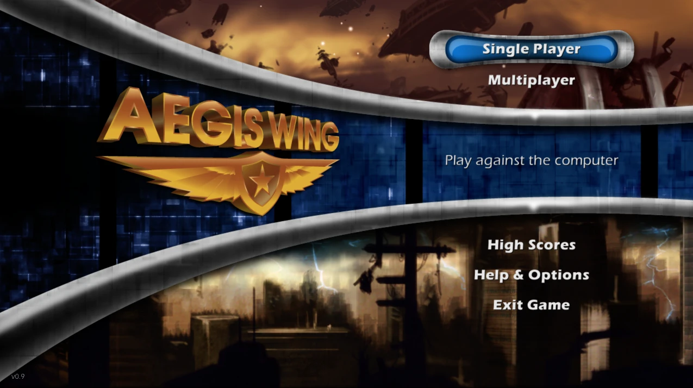
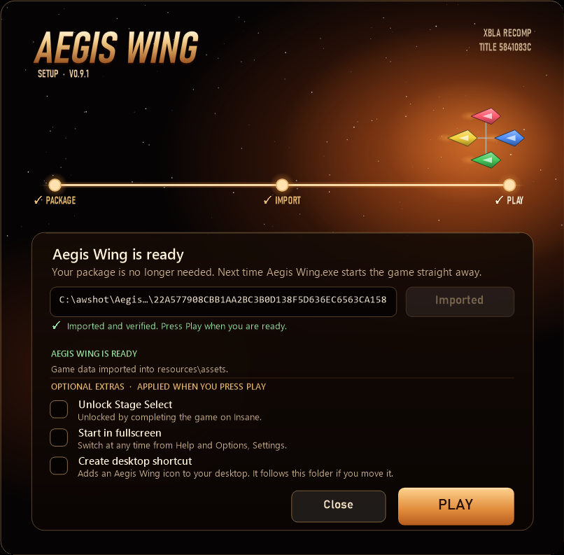
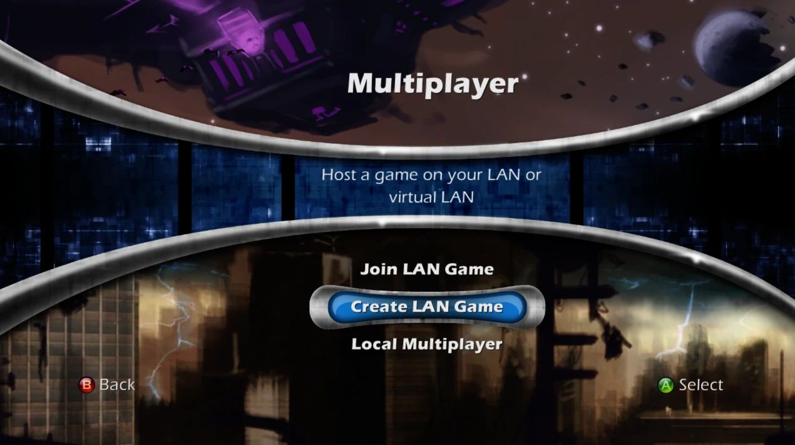
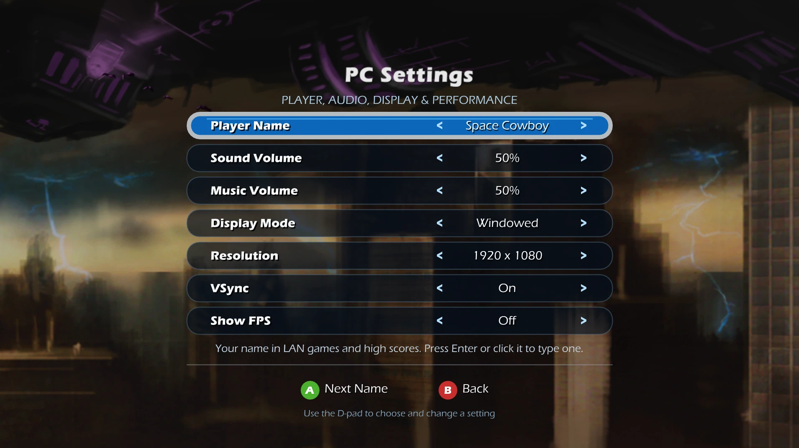

# Aegis Wing XBLA PC Recomp

A native Windows PC version of **Aegis Wing**, the 2007 Xbox Live Arcade
shoot-'em-up, created through static recompilation with
[ReXGlue](https://github.com/rexglue/rexglue-sdk). It supports up to 4K
resolution and a stable 60 FPS for gameplay. Keyboard and mouse, Xbox controllers,
local four-player co-op, LAN and online multiplayer has also been added through virtual LAN
services.

> **You need your own copy of Aegis Wing.** This project contains no original
> game executable, graphics, sound, music or other game data. The first time
> you start it, it reads the Xbox 360 Aegis Wing package you provide, checks
> that it is the supported version and imports the game data into its own
> folder on your PC.

If you enjoy the Aegis Wing XBLA PC Recomp and would like to support future projects, you can tip me on Ko-fi.

[](https://ko-fi.com/caiuscodes)



## Requirements

- Windows 10 or 11, 64-bit
- A graphics card with DirectX 12 support
- Your own Aegis Wing Xbox Live Arcade package (the Xbox 360 game file for
  Title ID `5841083C`)

Nothing else needs installing; the Visual C++ runtime is included. An Xbox
controller is optional.

## Install and play

1. Download the release ZIP from the
   [Releases](https://github.com/CaiusCodes/Aegis-Wing-XBLA-PC-Recomp/releases)
   page and extract it to a writable folder (not Program Files).
2. Open **Aegis Wing.exe**. The first time, a setup window opens. If your
   package sits beside it (or in a `Game Package` folder next to it) it is
   found and imported automatically; otherwise drag it onto the window or
   choose **Browse package**. The window tells you straight away if it is the
   wrong file or an unsupported version.
3. Pick any optional extras (Unlock Stage Select, fullscreen, desktop
   shortcut; all off unless ticked), then press **PLAY**.



From then on `Aegis Wing.exe` starts the game straight away. The game runs
from `resources\runtime`, the imported game data is in `resources\assets` and
saves, high scores and settings are in `resources\userdata`, so the folder can
be moved or backed up as a whole. Start `Aegis Wing.exe --setup` to change the
extras or import again; your saves and settings are kept. Coming from release
0.9.0 or 0.9.1 (Setup Aegis Wing.exe and a Game folder)? Extract this release
next to it or inside it and the old install is found, with your saves and
settings carried over; the old folder is never changed.

The launcher only reads your package and never changes it. It needs no
installation, no administrator rights and writes nothing to the registry.
Neither it nor the game contacts Xbox Live.

## Features

- **Native Windows PC build**: no emulator, runs as a normal Windows program
- **Single player** and **local co-op for up to 4 players** on one PC
- **LAN multiplayer** (Multiplayer → Join LAN Game / Create LAN Game), and
  **online multiplayer** through virtual LAN services such as ZeroTier,
  Radmin VPN and Tailscale
  
- **Up to 4K** (3840×2160) with **stable 60 FPS** gameplay
- **Xbox controller** support, plus full **keyboard and mouse** support in
  menus and gameplay
- **Settings menu** (Help & Options → Settings): player name, sound and music
  volume, windowed or fullscreen, resolution, VSync and an optional FPS
  counter
  
- **Local high scores** in place of the Xbox LIVE leaderboards
- Optional **Stage Select unlock** in the setup window (normally earned by
  completing the game on Insane)
- **Portable**: saves, settings and high scores stay in the game folder

### Controls

| Key / button | Action |
|---|---|
| Arrow keys | Fly, move through menus |
| Space | A (fire, confirm) |
| Shift | B (back) |
| Escape | Back in menus, pause during play |
| Enter | Start |
| X, Y | X and Y buttons |
| Mouse | Point at menu items; left click is A, right click is B |

An Xbox controller works as on the console. Without a controller, the title
screen says *Press Any Key*, and any key or click continues.

## Known limitations

- Windows only for now.
- Only the Xbox Live Arcade release with Title ID `5841083C` (game program
  version 0.0.1.3) is supported; the launcher refuses other builds.
- Xbox LIVE features are not available: multiplayer works through LAN or a
  virtual LAN only, and achievements and online leaderboards are replaced or
  removed.
- The launcher and the game are not digitally signed, so Windows SmartScreen
  may warn the first time; choose *More info* → *Run anyway*. Windows also
  asks for network access the first time you join or create a LAN game.

If something goes wrong, include the newest files from
`resources\runtime\logs` when reporting it.

## For Developers

Building from source. You need Git, CMake, Ninja, Clang and Windows PowerShell, plus
your own Aegis Wing package.

ReXGlue is the `rexglue-sdk` submodule, pinned to upstream v0.9.0. This
project's changes to it are kept in `patches/rexglue.patch`, which CMake
applies automatically. ReXGlue's dependencies are nested deeply, so enable
long paths when cloning:

```powershell
git -c core.longpaths=true clone --recurse-submodules --shallow-submodules https://github.com/CaiusCodes/Aegis-Wing-XBLA-PC-Recomp.git
```

Extract your package into `game/`, build the code generator, generate the
recompiled code from your own `default.xex`, then build the game:

```powershell
.\tools\Extract-STFS.ps1 -Path <your package> -OutputDir game
cmake --preset win-amd64-release
cmake --build --preset win-amd64-release --target rexglue
.\tools\Regenerate-Code.ps1
cmake --preset win-amd64-release
cmake --build --preset win-amd64-release --parallel
```

The game is built to `out/build/win-amd64-release/Aegis Wing.exe`.
`tools\Regenerate-Code.ps1` checks the XEX, runs the code generator and
applies the PC changes in `tools/Apply-GeneratedPcPatches.ps1`; the generated
code is never edited by hand or committed. `.\tools\Make-Release.ps1` builds
the release ZIP: the launcher (`packaging/launcher`, built by
`packaging/Build-Launcher.ps1`), the game in `resources\runtime`, README and
licences; never any game data. A game exe that sits in a folder named
`runtime` keeps its data in the folder above it; every other build (such as
`out/build/...`) keeps `assets` and `userdata` beside the exe.

## Licence and credits

This project's own code is released under the BSD 3-Clause licence (see
[LICENSE](LICENSE), which also lists what it does not cover).
`tools/Extract-STFS.ps1` and the launcher's package reader
(`packaging/launcher/stfs.cpp`) are derived from
[Velocity](https://github.com/hetelek/Velocity) and are GPL-3.0, which makes
the launcher program (`Aegis Wing.exe` in the release root) GPL-3.0 as a
whole; the game in `resources\runtime` is a separate program. ReXGlue,
which includes code derived from [Xenia](https://xenia.jp), and its
third-party libraries keep their own licences; see
[packaging/licenses](packaging/licenses).

Aegis Wing, Xbox and Xbox 360 are trademarks or property of Microsoft. This is
an unofficial fan project, not affiliated with or endorsed by Microsoft.
