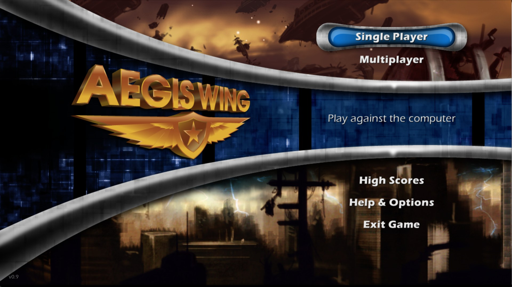
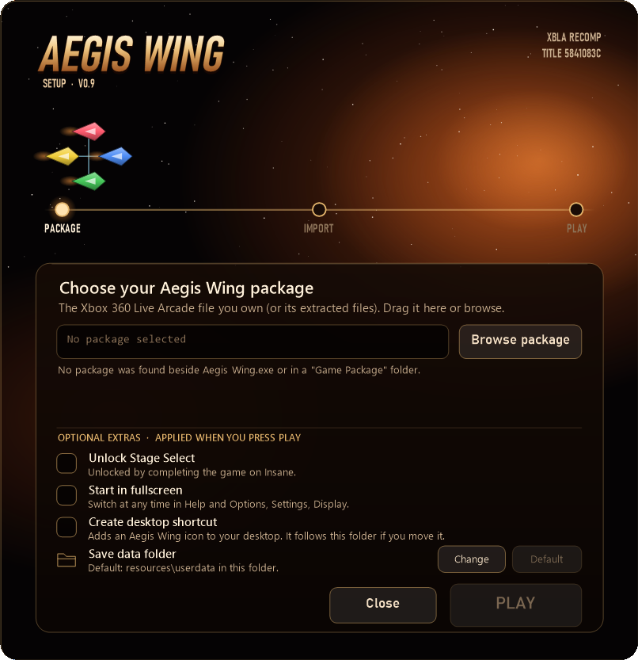
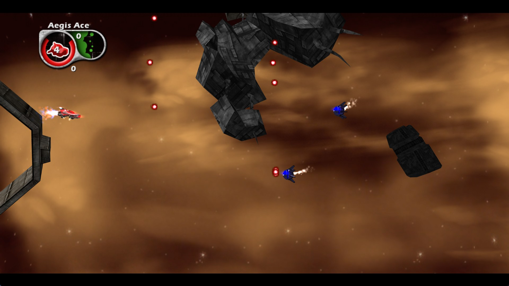
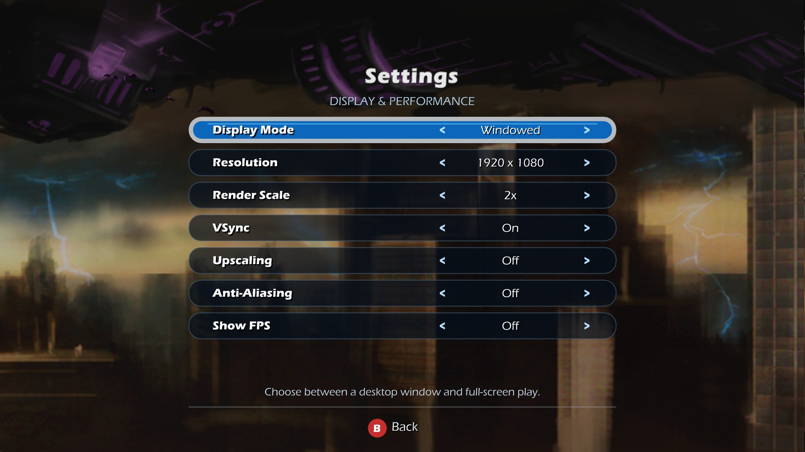
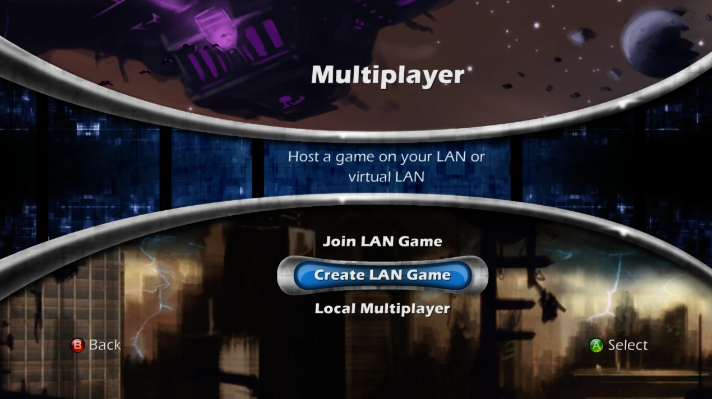

# Aegis Wing XBLA PC Recomp

A native Windows PC port of **Aegis Wing**, the 2007 Xbox Live Arcade co-op shoot-'em-up, built using [ReXGlue](https://github.com/rexglue/rexglue-sdk) static recompilation.

Play at **up to 4K and 60 FPS** with keyboard and mouse or an Xbox controller, four-player local co-op, and LAN / Virtual LAN multiplayer. No emulator required.

**Free and open-source.**

Like the recomp and want to support future projects? You can
tip me on [Ko-fi](https://ko-fi.com/caiuscodes).

[](https://ko-fi.com/caiuscodes)



> **You must provide your own copy of Aegis Wing XBLA.** No original game files or assets are distributed with this project. The launcher imports the required files from your Xbox 360 game package during first-time setup.

## Download & Installation

**[Download the latest release](https://github.com/CaiusCodes/Aegis-Wing-XBLA-PC-Recomp/releases)**

1. Download the latest ZIP and extract the **Aegis Wing** folder (not into Program Files).
2. Run `Aegis Wing.exe`.
3. Select your Aegis Wing XBLA package using **Browse Package**, or place it alongside the executable for automatic detection. Game files already extracted from the package (a folder with `default.xex` and `Media`) work too.
4. Choose your preferred options: Unlock Stage Select, fullscreen, desktop shortcut and where to keep your saves.
5. Click **Play**.



After setup, simply run `Aegis Wing.exe` to play. Your original game package is no longer needed.

**To reopen setup:** run `Aegis Wing.exe --setup` (for example from a shortcut).

The installation is portable, with imported game files, saves and settings stored inside the game folder, or your saves in a folder of your choice.

### System Requirements

- Windows 10 or 11 (64-bit)
- DirectX 12 or Vulkan-compatible graphics card
- Your own Aegis Wing XBLA package (Title ID `5841083C`, supported build only)

## Features

### Graphics & Performance

- **Native PC Rendering:** DirectX 12 on NVIDIA, Vulkan on other graphics cards
- **Up to 4K resolution** with fullscreen and windowed modes
- **60 FPS** gameplay with V-Sync and optional FPS counter
- **Render Scale:** 1x, 2x or 3x
- **AMD FSR 1** and **AMD CAS** upscaling and sharpening
- **FXAA** anti-aliasing
- Light on hardware: low CPU and GPU use, with light defaults for older PCs



### Controls & Quality of Life

- Full **keyboard and mouse** support with rebindable keys
- **Xbox controller** support
- Native PC settings menus
- Optional Stage Select unlock (normally earned by finishing the game on Insane)
- Local high scores in place of the Xbox LIVE leaderboards
- Built-in update checker
- Portable installation with local saves and settings



### Multiplayer

- **Four-player local co-op** on one PC
- **LAN multiplayer** and online play through Virtual LAN services
- Compatible with Radmin VPN, ZeroTier, Tailscale and Hamachi



## Keyboard & Mouse Controls

| Key | Action |
|---|---|
| Arrow Keys / W, A, S, D | Fly / Aim |
| Space / Left Click | Fire primary weapon (A) |
| Shift / Right Click | Fire secondary weapon (B) |
| X / R | Attach / Detach (X) |
| Y / E | Y |
| Q, F | Left and right bumpers |
| Esc | Pause / Back in menus |
| Enter | Start |
| Mouse | Point at and click menu items |

Keys can be customised under **Help & Options → Settings → Keyboard Controls**.

Xbox controllers use the original console controls.

## Updates

Check for new versions through **Help & Options → Settings → Check for Updates**. It asks GitHub for the newest release only when you choose it, and opens the download page if one is out.

To update, download the latest release ZIP and extract it over your existing installation. Your imported game files, saves and settings are kept.

Older installations using a separate setup executable and `Game` folder can also be imported during setup.

## Known Limitations

- Windows only.
- Only the supported Aegis Wing XBLA build (Title ID `5841083C`) is accepted.
- Xbox LIVE features are replaced: multiplayer runs over LAN or Virtual LAN, and high scores are kept locally.
- Windows SmartScreen may warn about the unsigned executable (choose **More info → Run anyway**).
- Windows Firewall may request permission for multiplayer connections.

## Reporting Issues

Found a bug? [Open a GitHub Issue](https://github.com/CaiusCodes/Aegis-Wing-XBLA-PC-Recomp/issues) and include your latest log from:

`resources\runtime\logs\`

**For performance or stuttering issues:**

1. Open `resources\userdata\aegis_wing.toml`.
2. Set `vblank_timing_log = true`.
3. Reproduce the issue and close the game.
4. Attach the latest `aegis_wing_NNN.log` to your report.
5. Set it back to `false` afterwards.

Logs never contain your Windows user name.

## Building from Source

You need Git, CMake, Ninja, Clang and Windows PowerShell, plus your own Aegis Wing package. ReXGlue is the `rexglue-sdk` submodule (upstream v0.9.0); this project's changes to it are in `patches/rexglue.patch`, which CMake applies automatically.

```powershell
git -c core.longpaths=true clone --recurse-submodules --shallow-submodules https://github.com/CaiusCodes/Aegis-Wing-XBLA-PC-Recomp.git
```

Extract your package into `game/`, build the code generator, generate the recompiled code from your own `default.xex`, then build the game:

```powershell
.\tools\Extract-STFS.ps1 -Path <your package> -OutputDir game
cmake --preset win-amd64-release
cmake --build --preset win-amd64-release --target rexglue
.\tools\Regenerate-Code.ps1
cmake --preset win-amd64-release
cmake --build --preset win-amd64-release --parallel
```

The game is built to `out/build/win-amd64-release/Aegis Wing.exe`. `.\tools\Make-Release.ps1` builds the release ZIP (launcher, game, README and licences; never any game data). After editing files in `rexglue-sdk`, save them back to the patch with `.\tools\Save-SdkPatch.ps1`; in a clone without submodules, `.\tools\Get-Sdk.ps1` fetches the SDK.

## Development & Credits

This project builds upon the work of:

- [ReXGlue](https://github.com/rexglue/rexglue-sdk) by Tom Clay and contributors – Static recompilation framework, including code derived from [Xenia](https://xenia.jp).
- [Velocity](https://github.com/hetelek/Velocity) – Xbox 360 package reader used by the launcher.
- [AMD FidelityFX](https://gpuopen.com/fidelityfx-superresolution/) – CAS and FSR 1 upscaling.

The project's own code is released under the [BSD 3-Clause licence](LICENSE). The launcher includes GPL-3.0 components derived from Velocity, and third-party dependencies retain their respective licences. See [packaging/licenses](packaging/licenses) for additional terms.

---

*Aegis Wing and Xbox are trademarks or property of Microsoft. This is an independent fan project and is not affiliated with or endorsed by Microsoft.*
